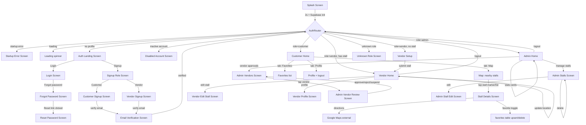

# VENDRGO — AGENT HANDOFF DOCUMENT

This document lets a new developer start working on the app without re-reading the codebase.

---

## 1. PROJECT OVERVIEW

**App name:** VendrGo  
**Package:** `vendr_go` (Flutter)  
**Version:** 1.0.0+1  
**Platform:** Android + iOS (Flutter mobile app)  
**Backend:** Supabase (Auth + Database + Realtime + Storage)  
**Purpose:** A local food-stall discovery app connecting nearby customers with food stalls in real time. Three user roles: **Customer**, **Vendor**, **Admin**.

**Core value prop:** "Find what's open near you." Customers see a map + list of approved stalls within 1 km, can filter by category/open-only, search, save favorites, and get Google Maps directions. Vendors register a stall, submit it for admin approval, then toggle open/closed and update location. Admins approve/reject/suspend vendors and manage all stalls.

---

## 2. TECH STACK & DEPENDENCIES

**Language:** Dart (SDK `^3.12.2`)  
**Framework:** Flutter (Material 3)  
**State management:** None (setState + Supabase streams/FutureBuilder)  
**Navigation:** Imperative `Navigator.push` / `pushReplacement` / named routes are NOT used; everything is material page routes.

**Production dependencies (pubspec.yaml):**
| Package | Version | Purpose |
|---|---|---|
| `supabase_flutter` | ^2.17.2 | Auth, DB, Realtime, Storage client |
| `flutter_map` | ^8.3.2 | OpenStreetMap map view (customer map screen) |
| `latlong2` | ^0.10.1 | Lat/Lng types for flutter_map |
| `geolocator` | ^14.1.1 | GPS location + permissions |
| `image_picker` | ^1.2.3 | Pick stall/menu images from gallery |
| `url_launcher` | ^6.3.2 | Open Google Maps directions link |
| `cupertino_icons` | ^1.0.8 | iOS-style icons |
| `flutter_lints` | ^6.0.0 | Lint rules (dev) |

**Assets:** `assets/vendrgo_logo.png` only.

**Supabase project (hardcoded in `lib/core/config/supabase_config.dart`):**
- URL: `https://azcglnqpmyuzgbdpmkrb.supabase.co`
- Publishable key: `sb_publishable_aCy9l7-GQbRnEZB_bY6Mmw_tP4KzWHK`
- Auth redirect URI: `vendrgo://auth-callback`
- Auth flow type: PKCE
- Storage bucket used: `vendrgo-media` (stall & menu images)

> ⚠️ These values are committed in source. Treat as project config, not secrets. If rotating, update `lib/core/config/supabase_config.dart` and the Supabase dashboard redirect URLs.

---

## 3. CODE ORGANIZATION (`lib/`)

```
lib/
├── main.dart                    # Entry point. Splash → Supabase init → AuthRouter → role-based home
├── core/
│   ├── config/
│   │   └── supabase_config.dart # Supabase URL/key/redirect URI
│   └── theme/
│       └── app_theme.dart       # VendrgoColors + VendrgoTheme.light() (Material 3)
├── services/
│   └── auth_services.dart       # AuthService singleton wrapper over Supabase auth
├── shared/
│   └── widgets/
│       ├── app_ui.dart          # VendrgoLogo, AppTextField, SectionCard, friendlyAuthError()
│       └── confirmation_dialog.dart # Reusable alert dialog (confirm/cancel)
├── features/
│   ├── auth/
│   │   └── auth_screens.dart    # ALL auth screens (landing, login, role choice, customer/vendor signup, email verify, forgot password, reset password)
│   ├── customer/
│   │   └── customer_home_screen.dart # Customer home: map + favorites + profile tabs, stall details
│   ├── vendor/
│   │   ├── vendor_setup_screen.dart      # First-time stall setup (images, location, submit for approval)
│   │   ├── vendor_home_screen.dart       # Vendor dashboard: open/close toggle, location update, edit stall, profile, logout
│   │   └── vendor_edit_stall_screen.dart # Edit stall info + re-upload images
│   └── admin/
│       └── admin_home_screen.dart        # Admin dashboard: stats, vendor approvals, manage stalls (edit/delete), review screens inline
└── test/
    └── widget_test.dart         # Empty placeholder (0 lines)
```

**Entry flow (`main.dart`):**
1. `main()` → `VendrgoApp` (Stateful, 2s splash + Supabase init with 10s timeout).
2. Splash shows `assets/vendrgo_logo.png` on `#FFF8EA` background.
3. After init: `AuthRouter` listens to `Supabase.auth.onAuthStateChange`, resolves user role from `profiles` table (+ `stalls` for vendors), then renders:
   - `AuthLandingScreen` (no profile)
   - `_DisabledAccountScreen` (`is_active != true`)
   - `CustomerHomeScreen` (role=customer)
   - `VendorSetupScreen` (role=vendor, no stall yet)
   - `VendorHomeScreen` (role=vendor, has stall)
   - `AdminHomeScreen` (role=admin)
   - `_UnknownRoleScreen` (fallback)
4. Startup failure → `StartupErrorScreen`.

---

## 4. DATABASE SCHEMA (INFERRED FROM CODE)

These tables are referenced in code. Create them in Supabase with RLS enabled before running the app.

### `profiles`
| Column | Type | Notes |
|---|---|---|
| `id` | uuid | References `auth.users.id`, PK |
| `role` | text | `customer` / `vendor` / `admin` |
| `full_name` | text | |
| `phone` | text | |
| `email` | text | |
| `is_active` | boolean | Admins can set false (suspend) |

### `stalls`
| Column | Type | Notes |
|---|---|---|
| `id` | uuid | PK |
| `vendor_id` | uuid | References `profiles.id` |
| `category_id` | uuid | References `categories.id` |
| `name` | text | Stall name |
| `description` | text | |
| `address` | text | |
| `latitude` / `longitude` | double precision | GPS coords |
| `opening_hours` | jsonb | e.g. `{"all": "9:00 AM – 5:00 PM"}` |
| `stall_image_path` | text | Storage path in `vendrgo-media` bucket |
| `menu_image_path` | text | Storage path in `vendrgo-media` bucket |
| `is_open` | boolean | Default false |
| `approval_status` | text | `pending` / `approved` / `rejected` / `suspended` |
| `rejection_reason` | text | Admin note on rejection |
| `location_updated_at` | timestamptz | |
| `created_at` / `updated_at` | timestamptz | |

### `categories`
| Column | Type | Notes |
|---|---|---|
| `id` | uuid | PK |
| `name` | text | e.g. "Street Food" |
| `created_by` | uuid | Vendor who created it |
| `is_active` | boolean | Default true |

### `favorites`
| Column | Type | Notes |
|---|---|---|
| `user_id` | uuid | References `profiles.id` |
| `stall_id` | uuid | References `stalls.id` |

### Storage bucket: `vendrgo-media`
Used for stall images (`{userId}/{timestamp}_stall.ext`) and menu images (`{userId}/{timestamp}_menu.ext`). Public URLs generated via `getPublicUrl`.

**Auth metadata (vendor signup only):** `signUpVendor` writes `stall_name`, `stall_description`, `category_name`, `stall_address`, `opening_hours` into `auth.user_metadata`. `VendorSetupScreen` reads these to pre-fill the form.

---

## 5. APP SCREEN MAP & FLOWS

### 5.1 Screen inventory (all screens in the app)

| # | Screen | File | Class | Role access |
|---|---|---|---|---|
| 1 | Splash | main.dart:92 | `SplashScreen` | All (transient) |
| 2 | Startup Error | main.dart:431 | `StartupErrorScreen` | All (error state) |
| 3 | Auth Router (internal, not a UI screen) | main.dart:114 | `AuthRouter` | All |
| 4 | Auth Landing | auth_screens.dart:11 | `AuthLandingScreen` | Guest |
| 5 | Login | auth_screens.dart:135 | `LoginScreen` | Guest |
| 6 | Forgot Password | auth_screens.dart:1134 | `ForgotPasswordScreen` | Guest |
| 7 | Reset Password | auth_screens.dart:1270 | `ResetPasswordScreen` | Guest (via email link) |
| 8 | Signup Role Choice | auth_screens.dart:320 | `SignupRoleScreen` | Guest |
| 9 | Customer Signup | auth_screens.dart:416 | `CustomerSignupScreen` | Guest |
| 10 | Vendor Signup | auth_screens.dart:619 | `VendorSignupScreen` | Guest |
| 11 | Email Verification | auth_screens.dart:930 | `EmailVerificationScreen` | Guest (post-signup) |
| 12 | Customer Home | customer_home_screen.dart:12 | `CustomerHomeScreen` | Customer |
| 13 | Stall Details (modal/push) | customer_home_screen.dart:1050 | `StallDetailsScreen` | Customer |
| 14 | Vendor Setup | vendor_setup_screen.dart:12 | `VendorSetupScreen` | Vendor (no stall yet) |
| 15 | Vendor Home / Dashboard | vendor_home_screen.dart:9 | `VendorHomeScreen` | Vendor |
| 16 | Vendor Profile | vendor_home_screen.dart:864 | `VendorProfileScreen` | Vendor (from home) |
| 17 | Edit Stall | vendor_edit_stall_screen.dart:9 | `VendorEditStallScreen` | Vendor |
| 18 | Admin Home / Dashboard | admin_home_screen.dart:8 | `AdminHomeScreen` | Admin |
| 19 | Vendor Approvals list | admin_home_screen.dart:186 | `AdminVendorsScreen` | Admin |
| 20 | Vendor Review (approve/reject/suspend) | admin_home_screen.dart:294 | `AdminVendorReviewScreen` | Admin |
| 21 | Manage Stalls list | admin_home_screen.dart:536 | `AdminStallsScreen` | Admin |
| 22 | Admin Edit Stall | admin_home_screen.dart:672 | `AdminStallEditScreen` | Admin |

Shared widgets: `VendrgoLogo`, `AppTextField`, `SectionCard`, `ConfirmationDialog`, `_ErrorBox`, `_RoleCard`, `_NavItem`, `_DetailRow`, `_StatCard`, `_AdminMenuCard`, `_AdminImage`, `_AdminField`, `_InfoLine`, `_ActionCard`, `_StatusChip`, `_ErrorState`, `_NearbyStallList`.

### 5.2 Navigation flow (Mermaid)



### 5.3 Role-based user journeys

**Customer journey:**
1. App opens → Splash → AuthRouter → if no session: Auth Landing.
2. Sign up as customer → email verification → Auth Router resolves role=customer → Customer Home.
3. Customer Home shows 3 tabs: Map (default), Favorites, Profile.
4. Map tab: loads location, streams `stalls` where `approval_status='approved'`, filters within 1 km, by search text, open-only toggle, category filter. Shows map markers (green=open, grey=closed) + scrollable list below.
5. Tap a stall → Stall Details: image, name, open/closed badge, category + distance, address, opening hours, description, menu image, "Get directions" (opens Google Maps), favorite heart toggle.
6. Favorites tab: lists favorited stalls (joins `favorites` + `stalls`), tap to open details.
7. Profile tab: name, email, phone, logout.

**Vendor journey:**
1. Sign up as vendor → enters owner + stall details (name, description, category, address, opening hours) → email verification → Auth Router: role=vendor, no stall yet → Vendor Setup.
2. Vendor Setup: pre-fills from auth metadata, picks stall image + menu image, gets GPS location, submits → inserts into `stalls` with `approval_status='pending'`, `is_open=false` → pushReplacement to Vendor Home.
3. Vendor Home: welcome card, stall card (name, description, approval-status chip), big OPEN/CLOSE button (only if approved + has location), Update Location, Edit Stall, Analytics (coming soon dialog), Profile, Logout.
4. Stall status: pending → "waiting for admin approval"; rejected → shows rejection reason; suspended → unavailable.
5. Edit Stall: loads current stall, edits name/description/category/address/hours, re-uploads images, saves → pops back.

**Admin journey:**
1. Sign up as admin (role set in DB directly; no admin signup UI exists — role must be `admin` in `profiles` table).
2. Admin Home: stats grid (customers, vendors, open stalls, pending approval), 3 menu cards: Vendor approvals, Manage stalls, Reports (coming soon).
3. Vendor approvals: lists stalls with `approval_status='pending'` joined to vendor profile. Tap → Vendor Review: vendor + stall info, images, Approve / Reject (enters reason) / Suspend (sets `is_active=false` on profile + `suspended` + `is_open=false` on stall).
4. Manage stalls: all stalls newest first, each row has Edit / Delete popup. Edit → Admin Stall Edit: all fields + approval-status dropdown + open toggle → save.
5. Logout from any admin screen.

---

## 6. FEATURES IMPLEMENTED (V1)

| Area | Feature | Status |
|---|---|---|
| Auth | Email/password sign in | ✅ |
| Auth | Customer signup + email verification | ✅ |
| Auth | Vendor signup (owner + stall metadata in auth metadata) + email verification | ✅ |
| Auth | Forgot password / reset password | ✅ |
| Auth | Role-based routing (customer/vendor/admin) | ✅ |
| Auth | Disabled account handling | ✅ |
| Customer | Map view of nearby approved stalls (flutter_map + OSM) | ✅ |
| Customer | Location-based filtering (1 km radius) | ✅ |
| Customer | Search by name/description/category | ✅ |
| Customer | Open-only filter | ✅ |
| Customer | Category filter (bottom sheet) | ✅ |
| Customer | Stall details + images + menu image | ✅ |
| Customer | Get directions (Google Maps via url_launcher) | ✅ |
| Customer | Favorite / unfavorite stall | ✅ |
| Customer | Favorites tab | ✅ |
| Customer | Profile + logout | ✅ |
| Vendor | First-time stall setup (images, location, hours) | ✅ |
| Vendor | Submit stall for admin approval | ✅ |
| Vendor | Toggle stall open/closed | ✅ |
| Vendor | Update GPS location | ✅ |
| Vendor | Edit stall details + re-upload images | ✅ |
| Vendor | Vendor profile | ✅ |
| Vendor | Logout | ✅ |
| Admin | Dashboard stats (customers, vendors, open, pending) | ✅ |
| Admin | Review pending vendors (approve/reject/suspend) | ✅ |
| Admin | Manage all stalls (edit/delete) | ✅ |
| Admin | Edit stall (status dropdown, open toggle) | ✅ |
| UI | Shared theme (VendrgoColors, Material 3) | ✅ |
| UI | Reusable widgets (text fields, cards, dialogs) | ✅ |
| Storage | Stall + menu image upload to Supabase Storage bucket `vendrgo-media` | ✅ |
| Realtime | `stalls` streamed to vendor home + customer map | ✅ |

**Not implemented / coming soon (explicitly noted in code):**
- Vendor analytics (`_showAnalyticsComingSoon` dialog only)
- Customer reporting/moderation (`Reports` card shows "Coming soon")
- No admin signup UI (admin role must be assigned directly in `profiles` table)
- No order/cart/checkout functionality
- No stall menu items (menu is just an image)
- No push notifications
- No password change (only reset via email)
- No stall search by distance beyond 1 km (hardcoded)

---

## 7. KEY FILES & WHERE TO MAKE CHANGES

| Goal | File |
|---|---|
| Change Supabase URL/key/redirect | `lib/core/config/supabase_config.dart` |
| Change app theme/colors | `lib/core/theme/app_theme.dart` |
| Add/modify auth flow | `lib/features/auth/auth_screens.dart` + `lib/services/auth_services.dart` |
| Add/modify customer screens | `lib/features/customer/customer_home_screen.dart` |
| Add/modify vendor screens | `lib/features/vendor/vendor_*_screen.dart` |
| Add/modify admin screens | `lib/features/admin/admin_home_screen.dart` |
| Add shared UI widget | `lib/shared/widgets/app_ui.dart` |
| App entry / routing / roles | `lib/main.dart` (`AuthRouter._buildRoot`, `_resolveRole`) |
| Lint rules | `analysis_options.yaml` (uses `flutter_lints/flutter.yaml`) |

---

## 8. GETTING STARTED (NEXT AGENT)

### Prerequisites
- Flutter SDK installed (`flutter --version` should work)
- Supabase project running at `https://azcglnqpmyuzgbdpmkrb.supabase.co` with the publishable key in `supabase_config.dart`
- Android Studio / Xcode for emulators, or a physical device

### Setup steps
1. `cd C:\vendr_go`
2. `flutter pub get`
3. Create the database tables (see Section 4) in Supabase SQL editor. Enable RLS on all tables.
4. Create the `vendrgo-media` storage bucket (public) in Supabase.
5. Add the auth redirect URL `vendrgo://auth-callback` to your Supabase Auth settings (URL Configuration → Redirect URLs).
6. For Android: ensure `android/app/src/main/AndroidManifest.xml` has internet permission and the `vendrgo://` intent filter if you want deep-link auth callbacks to return to the app. (Currently Supabase `emailRedirectTo` is set; verify the Android host is configured.)
7. `flutter run` (or `flutter run -d chrome` for web testing).

### Commands
- `flutter analyze` — static analysis (lint rules from `flutter_lints/flutter.yaml`)
- `flutter test` — runs `test/widget_test.dart` (currently empty)
- `flutter run` — start the app on a connected device/emulator

### Important notes for the next agent
- **No state-management library** is used; all state is local `setState`. If adding complex shared state, consider introducing a provider or riverpod pattern consistently.
- **Supabase auth redirect:** `signUpCustomer`, `signUpVendor`, and `sendPasswordReset` all pass `emailRedirectTo: SupabaseConfig.authRedirectUri` (`vendrgo://auth-callback`). Make sure this is whitelisted in Supabase or email links won't open the app.
- **Image upload bucket:** `vendrgo-media` must exist and be publicly readable (for `getPublicUrl` to work). Images are uploaded with `upsert: false`.
- **Auth metadata pre-fill:** Vendor signup stores stall fields in `auth.user_metadata`; `VendorSetupScreen._loadSignupData()` reads them. If you change signup fields, keep these in sync.
- **Role routing is in `main.dart` `AuthRouter._buildRoot`** — not a separate routing package. Adding a new role requires a case here.
- **The `test/widget_test.dart` is empty** (0 lines). No tests exist yet; consider adding widget/integration tests for auth and stall flows.
- **No `cred.env` file was found in the repo** — and per instructions it should be ignored anyway. All config is in `pubspec.yaml` and `lib/core/config/supabase_config.dart`.
- **.gitignore** covers `.dart_tool/`, `/build/`, `.idea/`, `*.iml`, logs, etc. Do not commit build artifacts.

---

## 9. FILES EXCLUDED (PER .gitignore + cred.env)

Per your instructions, `cred.env` and everything matched by `.gitignore` were not scanned/included:
- `cred.env` (not present in repo; ignored regardless)
- `.dart_tool/`, `.flutter-plugins-dependencies`, `.idea/`, `build/`, `coverage/`, `*.iml`, logs, DS_Store, etc.

---

*End of handoff. Generated from full repo scan of `C:\vendr_go` on 2026-10-28.*